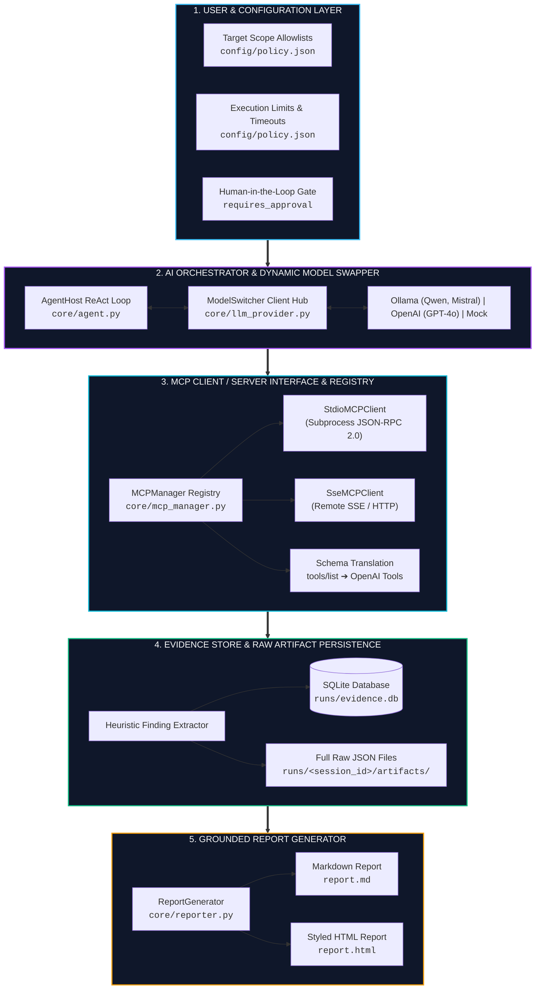
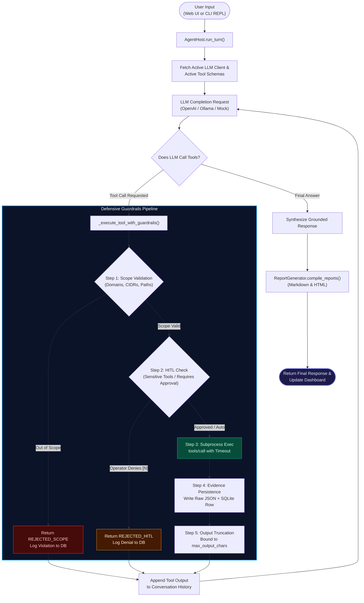
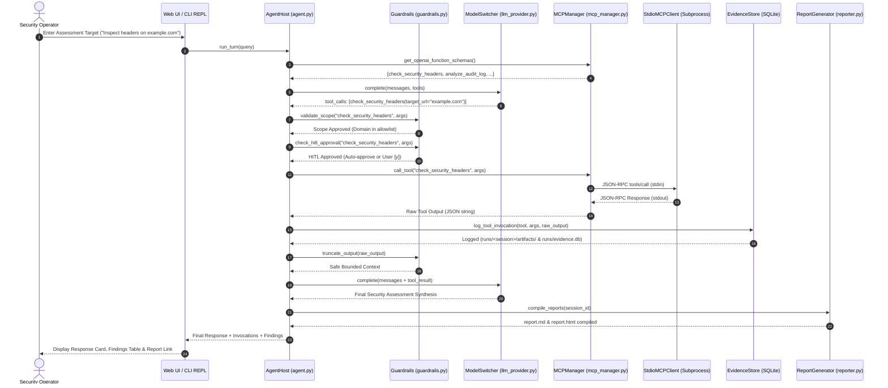
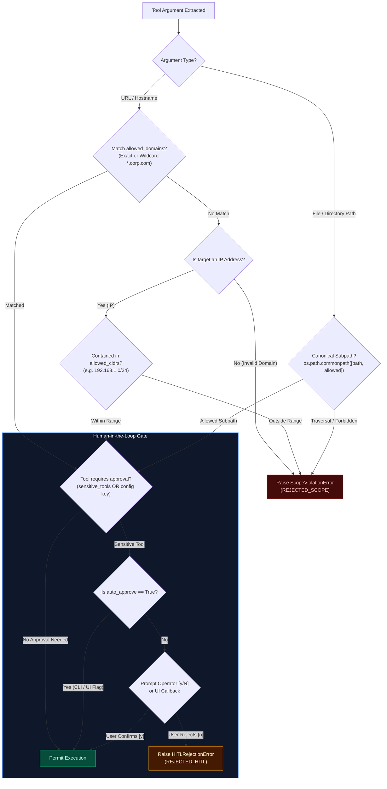

# MCP Agent Host — Engineering & Developer Reference Manual

This document provides a comprehensive, engineering-grade guide to the **Model Context Protocol (MCP) Agent Host** architecture, codebase internals, execution lifecycles, and extension APIs.

---

## 1. System Architecture & High-Level Design

The host implements the 5-layer decoupled architecture defined in `AI_Pentesting_Architecture_A4.pdf`:



### Component Decoupling & Invariants

1. **MCP Subprocess Persistence Across LLM Swaps**: The `ModelSwitcher` in `core/llm_provider.py` operates independently of `MCPManager` in `core/mcp_manager.py`. Changing models does **not** close, terminate, or restart spawned stdio subprocesses.
2. **Context Safety vs. Evidence Integrity**: The LLM prompt context is strictly bounded by `max_output_chars` in `core/guardrails.py` to prevent token exhaustion. However, the `EvidenceStore` in `core/evidence_store.py` always captures 100% of the raw, untruncated JSON output on disk.
3. **Fail-Closed Security Guardrails**: Every tool call requested by the LLM is intercepted before execution. If an argument targets an unauthorized domain, CIDR, or filesystem path, execution is blocked immediately, returning a structured rejection to the LLM and logging a `REJECTED_SCOPE` record.
4. **Human-in-the-Loop (HITL) Safety Gate**: Sensitive inspection tools require explicit operator confirmation before subprocess execution.

---

## 2. End-to-End Execution Lifecycle & Data Flow

### Request Lifecycle Flowchart



### End-to-End Sequence Diagram



---

## 3. Codebase & Module Deep Dive

### Directory Structure

```
AIenabPTtool/
├── config/
│   ├── models.json              # Model catalog, active model pointer & provider endpoints
│   ├── mcp_servers.json         # Server definitions, transports, args & approval rules
│   └── policy.json              # Scope allowlists (domains, CIDRs, paths) & safety gates
├── core/
│   ├── __init__.py              # Unified package exports
│   ├── agent.py                 # AgentHost orchestrator & interactive REPL shell
│   ├── llm_provider.py          # Unified LLM provider, Ollama auto-sync & ModelSwitcher
│   ├── mcp_manager.py           # MCP server lifecycle manager, transports & tool router
│   ├── guardrails.py            # Scope validation, timeouts, truncation & HITL middleware
│   ├── evidence_store.py        # SQLite persistence engine & filesystem artifact store
│   └── reporter.py              # Grounded Markdown & HTML assessment report compiler
├── servers/
│   ├── __init__.py
│   └── sample_inspector_mcp.py  # Reference safe stdio MCP inspection server
├── ui/
│   ├── __init__.py
│   ├── app.py                   # FastAPI application & REST endpoints
│   └── templates/
│       └── index.html           # Dark-mode Tailwind CSS Single-Page Application (SPA)
├── sample_data/
│   └── audit_sample.log         # Sample audit event log for testing
├── tests/
│   ├── __init__.py
│   ├── test_guardrails.py       # Scope, CIDR, path, HITL, truncation tests
│   ├── test_evidence_and_report.py # SQLite schema, artifact & report tests
│   ├── test_llm_provider.py     # Model switching, Ollama discovery & mock tests
│   ├── test_mcp_manager.py      # Stdio JSON-RPC, plug/unplug & routing tests
│   ├── test_ui_api.py           # FastAPI TestClient endpoint test suite
│   └── test_e2e_agent.py        # End-to-end multi-turn agent test
├── runs/                        # Session evidence databases, artifacts & reports
├── main.py                      # CLI entry point (REPL & non-interactive execution)
├── ui.py                        # Standalone Web Dashboard launcher
├── pyproject.toml               # Project metadata & packaging
├── pytest.ini                   # Asyncio test configuration
└── requirements.txt             # Pinned production & dev dependencies
```

---

### Module 1: `core/agent.py` (`AgentHost`)

The `AgentHost` coordinates the entire agentic tool-use loop:

- **State Management**:
  - `self.session_id`: Unique identifier for the assessment session (format: `session_YYYYMMDD_HHMMSS`).
  - `self.messages`: Conversation message history (`user`, `assistant`, `tool`).
  - `self.model_switcher`: Maintains active model and LLM client.
  - `self.mcp_manager`: Manages active MCP server processes.
  - `self.guardrails`: Enforces policy gates.
  - `self.evidence_store`: SQLite and artifact logging.
  - `self.reporter`: Compiles session findings.

- **Key Methods**:
  - `initialize()`: Connects to all enabled MCP servers defined in `config/mcp_servers.json`.
  - `run_turn(user_input: str, max_iterations: int = 5) -> str`: Executes the multi-turn ReAct loop. Queries the active LLM with discovered function schemas, intercepts `tool_calls`, executes them sequentially via `_execute_tool_with_guardrails`, feeds outputs back, and loops until the model outputs a final synthesis.
  - `_execute_tool_with_guardrails(tool_name: str, arguments: dict) -> (str, str, Optional[str])`: Coordinates scope check, HITL check, execution timeout, raw artifact persistence, and LLM context truncation.
  - `start_repl()`: Rich interactive console with slash commands (`/model`, `/models`, `/servers`, `/server enable/disable`, `/tools`, `/policy`, `/report`, `/clear`, `/help`, `/exit`).
  - `shutdown()`: Gracefully stops all MCP server processes and updates session status in SQLite to `COMPLETED`.

---

### Module 2: `core/llm_provider.py` (`ModelSwitcher` & LLM Clients)

Provides a unified interface across disparate LLM providers:

- **`BaseLLMClient` (Abstract Base Class)**:
  - `async def complete(messages: List[Dict], tools: Optional[List[Dict]]) -> LLMResponse`
  - Returns `LLMResponse(content, tool_calls, model, finish_reason, usage)`.
  - Normalizes tool calls into `ToolCall(id, name, arguments: dict)`.

- **Client Implementations**:
  - `OpenAICompatibleClient`: Uses `openai.AsyncOpenAI(base_url, api_key)` for OpenAI, vLLM, LM Studio, LocalAI, and Azure OpenAI endpoints. Resolves environment variable syntax like `${OPENAI_API_KEY}`.
  - `OllamaClient`: Connects to local Ollama instances (`http://localhost:11434/v1`). Performs tool calling against open-weight models (`qwen2.5`, `mistral`, `gemma2`).
    - *Auto-Detection on 404*: If Ollama returns HTTP 404 (`model not found`), `OllamaClient` automatically queries `http://localhost:11434/api/tags`, identifies installed models, and suggests the closest matching installed model.
  - `MockSecurityAgentClient`: Deterministic offline mock agent for testing, CI environments, or machines without local GPU/Ollama. Emits tool calls in Turn 1 and synthesizes structured findings in Turn 2.

- **`ModelSwitcher`**:
  - Loads profiles from `config/models.json`.
  - `switch_model(model_name: str) -> str`: Instantiates the new LLM client, updates `self.active_model_name`, and persists `"active_model"` in `config/models.json` **without touching active MCP server connections**.
  - `sync_installed_ollama_models() -> List[Dict]`: Queries `http://localhost:11434/api/tags` and automatically registers all locally downloaded models into `config/models.json`.

---

### Module 3: `core/mcp_manager.py` (`MCPManager` & Clients)

Manages the lifecycle, communication, and routing for all Model Context Protocol servers:

- **`StdioMCPClient` (Windows-Safe Architecture)**:
  - *Why not `asyncio.create_subprocess_exec`?* On Windows, `ProactorEventLoop` pipe transports often deadlock on anonymous pipes when reading stdout lines asynchronously.
  - *The Robust Solution*: `StdioMCPClient` manages subprocesses using standard `subprocess.Popen(..., text=True, encoding='utf-8')` and executes synchronous line reads inside `asyncio.to_thread(_send_sync, payload)`. This guarantees non-blocking, deadlock-free communication across Windows, Linux, and macOS.
  - *Handshake Protocol*:
    1. Sends `initialize` request (`protocolVersion: 2024-11-05`).
    2. Sends `notifications/initialized` notification.
    3. Calls `tools/list` to cache discovered tool schemas.

- **`SseMCPClient`**:
  - Remote MCP connector using Server-Sent Events / HTTP.

- **`MCPManager`**:
  - Loads definitions from `config/mcp_servers.json`.
  - `enable_server(name: str) -> bool`: Plugs in a server dynamically, conducts the handshake, and registers its tools into the active routing table.
  - `disable_server(name: str) -> bool`: Unplugs a server, stops the subprocess, and revokes its tools from the LLM function calling schema.
  - `get_openai_function_schemas() -> List[Dict]`: Translates MCP `tools/list` JSON schemas into standard OpenAI function calling format (`{"type": "function", "function": {"name": ..., "description": ..., "parameters": ...}}`).
  - `call_tool(tool_name: str, arguments: dict, timeout: float) -> Any`: Resolves namespaced or bare tool names to the appropriate server client.

---

### Module 4: `core/guardrails.py` (`GuardrailsMiddleware`)

Enforces policy safety gates defined in `config/policy.json`:

- **Scope Validation (`validate_scope`)**:
  - **Domains**: Extracts hostnames from URL arguments (`http://`, `https://`) or target keys. Compares against `allowed_domains` supporting exact matches and wildcard patterns (e.g. `*.example.com`).
  - **CIDR Ranges**: Parses IP targets using Python's `ipaddress.ip_address` and checks containment inside `allowed_cidrs` using `ipaddress.ip_network`.
  - **Path Traversal Protection**: Canonicalizes target paths (`os.path.abspath`) and verifies they are subpaths of authorized directories using `os.path.commonpath`. Blocks `../../etc/shadow` or unauthorized drive letters.
  - *Raises*: `ScopeViolationError`.

- **Human-in-the-Loop Gate (`check_hitl_approval`)**:
  - Checks if a tool is marked `requires_approval: true` in `config/mcp_servers.json` or listed under `sensitive_tools` in `config/policy.json`.
  - If `auto_approve == False`, prompts the operator (`[y/N]`) or triggers the `hitl_callback`.
  - *Raises*: `HITLRejectionError`.

- **Context Window Protection (`truncate_output`)**:
  - If tool output length exceeds `max_output_chars` (default 4000), it safely truncates the text and appends a footer referencing the full raw artifact file in the Evidence Store.

---

### Module 5: `core/evidence_store.py` (`EvidenceStore`)

Provides persistent SQLite auditing and filesystem artifact retention:

- **SQLite Database (`runs/evidence.db`)**:
  - `sessions`: `session_id` (PK), `created_at`, `model_name`, `target_scope`, `status`, `summary`.
  - `tool_invocations`: `id` (PK), `session_id`, `timestamp`, `server_name`, `tool_name`, `arguments`, `status` (`SUCCESS`, `TIMEOUT`, `REJECTED_SCOPE`, `REJECTED_HITL`, `FAILED`), `execution_time_ms`, `raw_output_path`, `truncated_output`, `error_message`.
  - `findings`: `id` (PK), `session_id`, `finding_id` (`HDR-001`, `LOG-001`), `severity` (`CRITICAL`, `HIGH`, `MEDIUM`, `LOW`, `INFORMATIONAL`), `title`, `target`, `description`, `evidence_ref`, `remediation`, `timestamp`.

- **Filesystem Artifacts (`runs/<session_id>/artifacts/`)**:
  - Every tool execution writes a dedicated JSON file: `<timestamp>_<tool_name>.json`. Contains full raw output, metadata, execution time, and arguments.

- **Heuristic Auto-Extraction (`_auto_extract_findings`)**:
  - Automatically parses structured responses from known defensive tools (e.g. `check_security_headers`, `analyze_audit_log`, `inspect_tls_cert`) and writes normalized records to the `findings` table.

---

### Module 6: `core/reporter.py` (`ReportGenerator`)

Compiles session evidence into audit deliverables:

- **Outputs**:
  - `runs/<session_id>/report.md`: Clean, GitHub-flavored Markdown.
  - `runs/<session_id>/report.html`: Standalone, styled HTML with severity badges, metrics cards, responsive tables, and remediation roadmaps.
- **Sections**:
  1. Executive Summary & Calculated Risk Breakdown.
  2. Scope Allowlist & Safety Gate Evaluation.
  3. Discovered Findings Table & Detailed Remediation Steps.
  4. Chronological Evidence Audit Trail with Execution Durations.
  5. Prioritized Remediation Roadmap (Immediate, Short-Term, Long-Term).

---

### Module 7: `ui/app.py` & `ui/templates/index.html` (Mission Control Web Dashboard)

- **Backend (`ui/app.py`)**:
  - FastAPI web server utilizing modern `lifespan` handler for clean startup/shutdown.
  - Comprehensive REST API endpoints for models, servers, tools, policy, chat, artifacts, and reports.
- **Frontend (`ui/templates/index.html`)**:
  - Responsive Single-Page Application (SPA) styled with Tailwind CSS and FontAwesome icons.
  - Live conversational workspace with real-time tool execution cards, artifact modal viewer, model switcher, server toggle switches, policy editor, and embedded HTML report previewer.

---

## 4. How to Build & Add New MCP Servers (Step-by-Step)

The host supports two transports: **stdio** (local processes) and **SSE/HTTP** (remote services).

### Transport 1: stdio (Standard Input / Output)

In stdio transport, the host launches your server as a child process and communicates via newline-delimited JSON-RPC 2.0 messages over standard streams.

#### Stdio Hygiene Rules (Critical!)
1. **Never print debug messages, logs, or banners to `sys.stdout`**: `stdout` is reserved exclusively for JSON-RPC 2.0 messages. Any non-JSON print statement will corrupt the JSON parser.
2. **Send all logs to `sys.stderr`**: The host ignores stderr or captures it separately for diagnostics.
3. **Always flush streams**: Call `sys.stdout.flush()` immediately after writing every JSON-RPC response.
4. **Delimit with newlines**: Write each JSON-RPC response as a single line ending in `\n`.

#### Standard Protocol Contract

```mermaid
sequenceDiagram
    autonumber
    participant Host as MCP Host (AgentHost)
    participant Client as StdioMCPClient
    participant Subprocess as MCP Server Process (stdio)

    rect rgb(15, 23, 42)
        Note over Host,Subprocess: Phase 1: Connection & Capabilities Handshake
        Host->>Client: connect()
        Client->>Subprocess: Launch subprocess via popen()
        Client->>Subprocess: {"jsonrpc":"2.0","id":1,"method":"initialize",...}\n
        Subprocess-->>Client: {"jsonrpc":"2.0","id":1,"result":{"capabilities":{...}}}\n
        Client->>Subprocess: {"jsonrpc":"2.0","method":"notifications/initialized","params":{}}\n
    end

    rect rgb(11, 19, 43)
        Note over Host,Subprocess: Phase 2: Dynamic Tool Discovery
        Host->>Client: list_tools()
        Client->>Subprocess: {"jsonrpc":"2.0","id":2,"method":"tools/list","params":{}}\n
        Subprocess-->>Client: {"jsonrpc":"2.0","id":2,"result":{"tools":[...]}}\n
        Client-->>Host: Tool schemas cached & converted to OpenAI format
    end

    rect rgb(20, 24, 39)
        Note over Host,Subprocess: Phase 3: Runtime Tool Execution
        Host->>Client: call_tool(name, args)
        Client->>Subprocess: {"jsonrpc":"2.0","id":3,"method":"tools/call","params":{...}}\n
        Subprocess-->>Client: {"jsonrpc":"2.0","id":3,"result":{"content":[...],"isError":false}}\n
        Client-->>Host: Return parsed result string
    end
```



1. **`initialize` (Request)**:
   ```json
   {"jsonrpc": "2.0", "id": 1, "method": "initialize", "params": {"protocolVersion": "2024-11-05"}}
   ```
   **Response**:
   ```json
   {"jsonrpc": "2.0", "id": 1, "result": {"protocolVersion": "2024-11-05", "capabilities": {"tools": {}}, "serverInfo": {"name": "my_server", "version": "1.0.0"}}}
   ```

2. **`notifications/initialized` (Notification)**:
   ```json
   {"jsonrpc": "2.0", "method": "notifications/initialized", "params": {}}
   ```
   *No response required.*

3. **`tools/list` (Request)**:
   ```json
   {"jsonrpc": "2.0", "id": 2, "method": "tools/list", "params": {}}
   ```
   **Response**:
   ```json
   {
     "jsonrpc": "2.0",
     "id": 2,
     "result": {
       "tools": [
         {
           "name": "lookup_dns_records",
           "description": "Inspects DNS A, AAAA, MX, and TXT records for an authorized domain.",
           "inputSchema": {
             "type": "object",
             "properties": {
               "domain": {"type": "string", "description": "Target domain name"}
             },
             "required": ["domain"]
           }
         }
       ]
     }
   }
   ```

4. **`tools/call` (Request)**:
   ```json
   {"jsonrpc": "2.0", "id": 3, "method": "tools/call", "params": {"name": "lookup_dns_records", "arguments": {"domain": "example.com"}}}
   ```
   **Response**:
   ```json
   {
     "jsonrpc": "2.0",
     "id": 3,
     "result": {
       "content": [
         {
           "type": "text",
           "text": "{\"domain\": \"example.com\", \"records\": {\"A\": [\"93.184.216.34\"]}}"
         }
       ],
       "isError": false
     }
   }
   ```

---

### Complete Working Example: Building a Custom DNS Inspector Server

#### Step 1: Create the Server File (`servers/dns_inspector_mcp.py`)

```python
#!/usr/bin/env python3
"""
Custom Safe Stdio MCP Server: DNS Inspector
"""
import sys
import json
import socket

SERVER_NAME = "dns_inspector"

def log_debug(msg: str) -> None:
    sys.stderr.write(f"[{SERVER_NAME}] {msg}\n")
    sys.stderr.flush()

def lookup_dns(domain: str) -> dict:
    try:
        # Standard library socket resolution
        addr_info = socket.getaddrinfo(domain, None)
        ips = sorted(list(set(item[4][0] for item in addr_info)))
        return {
            "domain": domain,
            "resolved_ips": ips,
            "status": "RESOLVED"
        }
    except Exception as e:
        return {"domain": domain, "error": str(e), "status": "FAILED"}

def handle_request(req: dict) -> dict:
    method = req.get("method")
    msg_id = req.get("id")

    if method == "initialize":
        return {
            "jsonrpc": "2.0",
            "id": msg_id,
            "result": {
                "protocolVersion": "2024-11-05",
                "capabilities": {"tools": {}},
                "serverInfo": {"name": SERVER_NAME, "version": "1.0.0"}
            }
        }

    if method == "notifications/initialized":
        return None

    if method == "tools/list":
        return {
            "jsonrpc": "2.0",
            "id": msg_id,
            "result": {
                "tools": [
                    {
                        "name": "lookup_dns",
                        "description": "Performs read-only DNS address resolution for an authorized domain.",
                        "inputSchema": {
                            "type": "object",
                            "properties": {
                                "domain": {"type": "string", "description": "Target domain (e.g. 'example.com')"}
                            },
                            "required": ["domain"]
                        }
                    }
                ]
            }
        }

    if method == "tools/call":
        params = req.get("params", {})
        args = params.get("arguments", {})
        res = lookup_dns(args.get("domain", ""))
        return {
            "jsonrpc": "2.0",
            "id": msg_id,
            "result": {
                "content": [{"type": "text", "text": json.dumps(res, indent=2)}],
                "isError": "error" in res
            }
        }

    return {"jsonrpc": "2.0", "id": msg_id, "error": {"code": -32601, "message": "Method not found"}}

def main():
    log_debug("Starting stdio loop...")
    while True:
        line = sys.stdin.readline()
        if not line:
            break
        line = line.strip()
        if not line:
            continue
        try:
            req = json.loads(line)
            resp = handle_request(req)
            if resp is not None:
                sys.stdout.write(json.dumps(resp) + "\n")
                sys.stdout.flush()
        except Exception as e:
            log_debug(f"Error handling request: {e}")

if __name__ == "__main__":
    main()
```

#### Step 2: Register in `config/mcp_servers.json`

Add the server definition under `"servers"`:

```json
"dns_inspector": {
  "name": "dns_inspector",
  "description": "Read-only DNS resolver for authorized target domains",
  "transport": "stdio",
  "command": "python",
  "args": ["-m", "servers.dns_inspector_mcp"],
  "cwd": ".",
  "env": {},
  "enabled": true,
  "requires_approval": false,
  "tools_require_approval": []
}
```

#### Step 3: Verify Dynamically
- In the Web UI: Navigate to **MCP Server Registry**, click **Toggle** to plug in `dns_inspector`.
- In CLI REPL: Type `/server enable dns_inspector`.
- Discovered tool `lookup_dns` is automatically available to the active LLM.

---

### Transport 2: SSE / HTTP (Remote Servers)

For remote or cloud-hosted MCP servers:

```json
"remote_compliance_scanner": {
  "name": "remote_compliance_scanner",
  "description": "Remote enterprise audit server via SSE",
  "transport": "sse",
  "url": "https://mcp.internal.corp/sse",
  "headers": {
    "Authorization": "Bearer ${CORP_MCP_TOKEN}"
  },
  "enabled": false,
  "requires_approval": true
}
```

The host connects via HTTP POST/SSE streams and automatically recovers if the remote connection drops.

---

## 5. Adding & Customizing LLM Providers

### Adding Models in `config/models.json`

The host supports four provider types: `ollama`, `openai`, `custom_openai`, and `mock`.

```json
{
  "active_model": "ollama/qwen2.5:3b",
  "providers": {
    "ollama": {
      "type": "ollama",
      "base_url": "http://localhost:11434/v1"
    },
    "vllm": {
      "type": "custom_openai",
      "base_url": "http://192.168.1.50:8000/v1",
      "api_key": "${VLLM_API_KEY:-token}"
    }
  },
  "models": {
    "vllm/qwen2.5-coder": {
      "provider": "vllm",
      "model_name": "Qwen/Qwen2.5-Coder-32B-Instruct",
      "temperature": 0.1,
      "max_tokens": 8192,
      "context_window": 32768,
      "description": "Local vLLM server with Qwen 2.5 Coder 32B"
    }
  }
}
```

### Tool Calling with Open-Weight Models

Smaller models (e.g. `qwen2.5:3b`, `gemma2:2b`, `mistral7b:latest`) require clean, concise JSON schemas. The host automatically:
- Formats parameter descriptions clearly.
- Strips unsupported schema attributes.
- Parses malformed JSON arguments gracefully if the model emits escaped strings.

---

## 6. Scope Validation, Guardrails & HITL Extension

### Guardrails Decision Flowchart



### How `core/guardrails.py` Works

1. **Domain Matching**:
   ```python
   def is_domain_allowed(self, target: str) -> bool:
       for pattern in self.allowed_domains:
           if pattern == "*": return True
           if pattern.startswith("*.") and (target == pattern[2:] or target.endswith("." + pattern[2:])):
               return True
           if fnmatch.fnmatch(target, pattern) or target == pattern:
               return True
       return False
   ```
2. **CIDR Matching**:
   Uses Python's `ipaddress` library to parse any IPv4/IPv6 target and determine whether it resides within any subnet defined in `allowed_cidrs`.
3. **Path Traversal Protection**:
   Uses `os.path.commonpath([canonical_target, canonical_allowed]) == canonical_allowed` to strictly prevent `../` attacks.

### Extending with Custom Validators

To add custom validations (e.g. port allowlisting), subclass or extend `GuardrailsMiddleware.validate_scope`:

```python
def validate_scope(self, tool_name: str, arguments: dict) -> None:
    # Existing domain, CIDR, and path checks...
    super().validate_scope(tool_name, arguments)

    # Custom Port Check
    port = arguments.get("port")
    if port and port not in [80, 443, 8080]:
        raise ScopeViolationError(f"Port {port} is not in authorized scan ports.")
```

---

## 7. Evidence Store & Report Customization

### SQLite Database Schema (`runs/evidence.db`)

```sql
CREATE TABLE sessions (
    session_id TEXT PRIMARY KEY,
    created_at TEXT NOT NULL,
    model_name TEXT NOT NULL,
    target_scope TEXT,
    status TEXT DEFAULT 'IN_PROGRESS',
    summary TEXT
);

CREATE TABLE tool_invocations (
    id INTEGER PRIMARY KEY AUTOINCREMENT,
    session_id TEXT NOT NULL,
    timestamp TEXT NOT NULL,
    server_name TEXT NOT NULL,
    tool_name TEXT NOT NULL,
    arguments TEXT NOT NULL,
    status TEXT NOT NULL,
    execution_time_ms REAL,
    raw_output_path TEXT,
    truncated_output TEXT,
    error_message TEXT,
    FOREIGN KEY (session_id) REFERENCES sessions(session_id)
);

CREATE TABLE findings (
    id INTEGER PRIMARY KEY AUTOINCREMENT,
    session_id TEXT NOT NULL,
    finding_id TEXT NOT NULL,
    severity TEXT NOT NULL,
    title TEXT NOT NULL,
    target TEXT NOT NULL,
    description TEXT,
    evidence_ref TEXT,
    remediation TEXT,
    timestamp TEXT NOT NULL,
    FOREIGN KEY (session_id) REFERENCES sessions(session_id)
);
```

### Customizing the HTML Report Template

The HTML report in `core/reporter.py` is fully standalone with CSS variables for colors, typography, and severity badges (`.badge-critical`, `.badge-high`, `.badge-medium`, `.badge-low`). You can customize the header branding, embed corporate logos, or add custom assessment metadata directly in `ReportGenerator.generate_html_report()`.

---

## 8. Testing & Contribution Guidelines

### Running the Test Suite

```bash
# Run all tests with verbose output
pytest -v

# Run a specific test module
pytest tests/test_guardrails.py -v
pytest tests/test_mcp_manager.py -v
pytest tests/test_ui_api.py -v
```

### Test Suite Structure

| Test File | Focus Areas |
| :--- | :--- |
| `tests/test_guardrails.py` | Domain allowlists, wildcards, CIDR subnets, path traversal, HITL callbacks, truncation limits |
| `tests/test_evidence_and_report.py` | SQLite session creation, invocation logging, raw JSON artifacts, Markdown & HTML report compilation |
| `tests/test_llm_provider.py` | Dynamic model switching without dropping MCP connections, Ollama error suggestions, Mock completions |
| `tests/test_mcp_manager.py` | Subprocess stdio JSON-RPC handshake, tool discovery, dynamic plug/unplug, schema translation |
| `tests/test_ui_api.py` | FastAPI TestClient endpoint coverage (`/api/status`, `/api/models`, `/api/servers/toggle`, `/api/chat`, reports) |
| `tests/test_e2e_agent.py` | End-to-end multi-turn agent execution and evidence generation |

### Contribution Hygiene
1. **Never commit secrets**: Check that `.env` or sensitive API keys are not in `config/models.json`.
2. **Never commit session artifacts**: Keep `runs/` in `.gitignore`.
3. **Verify subprocess cleanup**: Always call `await agent.shutdown()` in tests to prevent orphan processes.
4. **Ensure tests pass**: Run `pytest -v` and confirm 100% pass rate before opening a PR.
