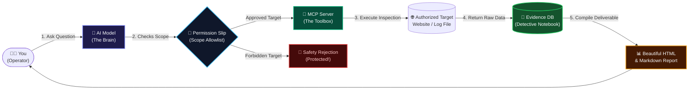
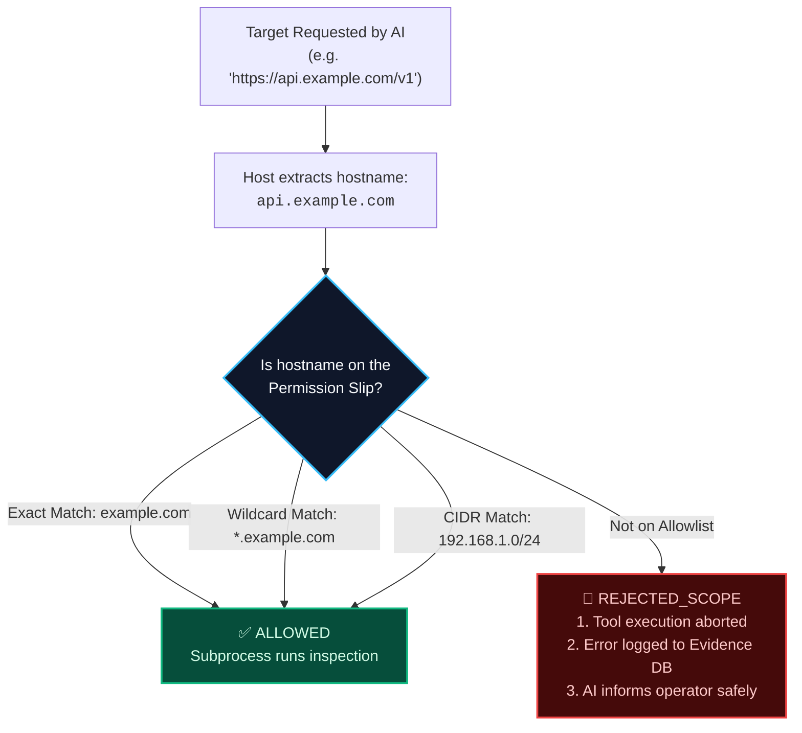

# The Friendly Beginner-to-Pro Guide to MCP Agent Host 🛡️🤖

Welcome! Whether you are a curious beginner who has never used an AI agent before, or a seasoned cybersecurity practitioner looking to automate defensive security assessments, this guide is designed for you.

We will start with the very basics using fun, everyday analogies, and gradually level up to advanced pro features!

---

## 🧭 Table of Contents

1. [Friendly Introduction: What Is This Tool?](#friendly-introduction-what-is-this-tool)
2. [The 5 Magic Concepts (Kid-Friendly Explanation)](#the-5-magic-concepts-kid-friendly-explanation)
3. [Level 1 — Beginner: Getting Started in 5 Minutes](#level-1--beginner-getting-started-in-5-minutes)
4. [Level 2 — Explorer: Connecting a Real Local AI Brain (Ollama)](#level-2--explorer-connecting-a-real-local-ai-brain-ollama)
5. [Level 3 — Practitioner: Setting Permission Slips & Checking Targets](#level-3--practitioner-setting-permission-slips--checking-targets)
6. [Level 4 — Pro: Plugging In Toolboxes, Safety Gates & Reports](#level-4--pro-plugging-in-toolboxes-safety-gates--reports)
7. [Cheat Sheet: Prompt Ideas & Slash Commands](#cheat-sheet-prompt-ideas--slash-commands)
8. [Troubleshooting FAQ](#troubleshooting-faq)

---

## 🌟 Friendly Introduction: What Is This Tool?

Imagine you have a super-smart robot assistant. You want this assistant to help you inspect computers and websites to make sure they are safe, secure, and properly protected against cyber risks.

Normally, AI bots just talk in text. But **this tool gives your AI hands!** It connects your AI to safe, standardized toolboxes (called **MCP Servers**) that can inspect website headers, check SSL certificates, and read security logs.



Best of all:
- **You can swap the AI's brain** anytime (from a completely free, private model running on your laptop like Ollama, to a cloud model like GPT-4o, or even an offline simulator).
- **The robot has strict safety rules (guardrails)**: It can only touch things you gave it permission to see.
- **It keeps a detective notebook**: Every single thing the AI tests is written down in a database and turned into a beautiful, professional report!

---

## 🧩 The 5 Magic Concepts (Kid-Friendly Explanation)

To understand this entire project, you only need to know 5 simple ideas:

| Concept | The Analogy | Real World Meaning | What Happens If It Fails? |
| :--- | :--- | :--- | :--- |
| **1. AI Model** | 🧠 **The Brain** | The language model (Qwen, Mistral, GPT-4) reading and reasoning. | If model is missing, switch with 1-click to `mock/security-agent`. |
| **2. MCP Server** | 🧰 **The Toolbox** | A mini-program providing specific tools (headers, TLS, logs). | If unplugged, the AI cannot run those specific checks. |
| **3. Scope / Allowlist** | 📜 **The Permission Slip** | Strict list of authorized domains, IP ranges, and local folders. | If target is not on the list, the AI refuses to touch it! |
| **4. HITL Approval** | 🙋 **Asking Before Acting** | "Human-in-the-Loop". Pauses before running sensitive tools. | If you say [N], the tool is aborted and logged as denied. |
| **5. Evidence & Report** | 📓 **The Detective Notebook** | SQLite database and raw JSON files compiling final HTML reports. | Untruncated raw evidence is always preserved on disk. |

### Visual Sequence: What Happens When You Click Execute

```mermaid
sequenceDiagram
    autonumber
    actor You as 🧑‍💻 Operator (You)
    participant Brain as 🧠 AI Brain (Model)
    participant Slip as 📜 Permission Slip (Guardrails)
    participant Box as 🧰 Toolbox (MCP Server)
    participant Book as 📓 Detective Notebook (Evidence Store)

    You->>Brain: "Check headers for https://example.com"
    Brain->>Slip: Can I inspect example.com?
    alt In Authorized Scope
        Slip-->>Brain: ✅ Yes, example.com is on the Permission Slip!
        Brain->>Box: Run tool: check_security_headers("example.com")
        Box-->>Book: Save raw JSON audit evidence
        Box-->>Brain: Return findings (Missing HSTS, CSP, etc.)
        Brain-->>You: Friendly explanation with grades & remediation advice!
    else Unauthorized Scope
        Slip-->>Brain: 🛑 NO! Target is NOT on the Permission Slip!
        Slip-->>Book: Log REJECTED_SCOPE violation
        Brain-->>You: "I cannot inspect this target because it is out of scope."
    end
```

---

## 🟢 Level 1 — Beginner: Getting Started in 5 Minutes

Let's get the tool running on your computer right away!

### Step 1: Open Your Terminal & Activate the Virtual Environment

Open PowerShell (Windows) or Terminal (Mac/Linux) in the project folder:

```powershell
# Activate the virtual environment
.\venv\Scripts\Activate.ps1   # On Windows
# or: source venv/bin/activate  # On Linux / macOS
```

### Step 2: Launch the Mission Control Web Dashboard

You have two ways to run the tool. For beginners, the **Web Dashboard** gives the best experience:

```bash
python ui.py
```
*(Or if you prefer: `python main.py --ui`)*

You will see:
```
=================================================================
  🛡️  MCP AGENT HOST INTERACTIVE MISSION CONTROL
=================================================================
  Dashboard URL : http://127.0.0.1:8000
  API Docs (OAS): http://127.0.0.1:8000/docs
=================================================================
```

Now open your web browser (Chrome, Edge, Firefox, Safari) and go to:
👉 **[http://127.0.0.1:8000](http://127.0.0.1:8000)**

*(Prefer the classic black-and-green hacker terminal? You can also just type `python main.py` for the interactive command line REPL!)*

---

### Step 3: Tour of the 5 Dashboard Tabs

When the dashboard opens, you will see a sleek dark-themed interface with 5 tabs on the left:

1. 💬 **Agent Workspace**: Your main chat window where you talk to the AI, see its step-by-step reasoning, and view real-time tool execution cards.
2. 🧠 **Models & Reasoning**: Where you choose which AI brain to use with just one click!
3. 🔌 **MCP Server Registry**: Where you turn toolboxes ON and OFF like light switches.
4. 🛡️ **Scope & Guardrails**: Your safety control room where you list authorized domains, IP ranges, and local folders.
5. 📊 **Evidence & Reports**: Your findings table, raw artifact viewer, and live HTML report preview.

---

### Step 4: Your First 60-Second Walkthrough (Offline Simulator)

Let's test the agent right now without needing any API keys or heavy GPU downloads!

1. Look at the top-right header: by default, the active model is set to `ollama/qwen2.5:3b` or `mock/security-agent`.
2. If you don't have Ollama running yet, select **`mock/security-agent`** from the Model dropdown in the header. (This is our built-in offline simulator!).
3. In the chat box at the bottom, click one of the quick prompt chips:
   > **`📜 Analyze Audit Log: audit_sample.log`**
4. Click **Execute** (or press Enter).
5. Watch the magic happen:
   - The AI reasons about your request.
   - A tool card appears: `⚙️ analyze_audit_log on [security_inspector]`.
   - The AI inspects the log, discovers failed login attempts and 403 errors, and writes down structured findings!
   - You can click **"View Full Raw Artifact"** on the tool card to see the exact raw JSON data!

---

## 🟡 Level 2 — Explorer: Connecting a Real Local AI Brain (Ollama)

Now let's connect a real, private, open-source AI brain that runs 100% locally on your computer with **zero cloud fees and total privacy**!

### Step 1: Install & Start Ollama
If you don't have Ollama yet, download it from [ollama.com](https://ollama.com). Once installed, start the service in a separate terminal:

```bash
ollama serve
```

### Step 2: Download a Model
In your terminal, download a model. We recommend **Qwen 2.5 3B** because it is lightweight (only ~1.9 GB), very fast, and natively understands tool calling:

```bash
ollama pull qwen2.5:3b
```
*(Have a powerful gaming PC or GPU? You can also pull `ollama pull qwen2.5:7b` or `ollama pull mistral7b:latest`!)*

### Step 3: Auto-Detect Your Models in the Web UI!
1. In the Web Dashboard, click the **Models & Reasoning** tab.
2. Click the amber button: **`🔄 Sync Local Ollama Models`**.
3. The dashboard connects to your local Ollama instance, automatically discovers all models you have downloaded, and displays them as cards!
4. Find **`ollama/qwen2.5:3b`** and click **Select Model**.

### 💡 Fixing the "404 - Model Not Found" Error
If you ever see an error message like:
> `Error code: 404 - model 'qwen2.5:7b' not found`

**Don't panic!** This simply means Ollama is running, but you haven't downloaded that specific model size yet.
- **Option A**: Run `ollama pull qwen2.5:7b` in your terminal.
- **Option B**: Just switch to a model you *already* have installed (like `qwen2.5:3b`) using the dropdown in the header or typing `/model ollama/qwen2.5:3b`!

---

## 🟠 Level 3 — Practitioner: Setting Permission Slips & Checking Targets

Now you are ready to conduct real security checks. But first, let's learn how **Scope Allowlists** protect you.

### What is the "Permission Slip" (Scope Allowlist)?

In cybersecurity, scanning or inspecting systems without authorization is strictly prohibited. The MCP Agent Host prevents accidental mistakes by enforcing a strict **Scope Allowlist** in `config/policy.json`.



In the dashboard, click **Scope & Guardrails**:
1. **Authorized Domains**:
   - Enter domains like `example.com`, `localhost`, `127.0.0.1`, or wildcards like `*.example.com`.
   - ⚠️ *Tip*: Enter just the domain name (`example.com`), not the full URL with slashes. The agent automatically extracts the domain from any URL you type!
2. **Authorized CIDRs (IP Ranges)**:
   - For a single computer: `127.0.0.1/32`
   - For your local home/office network: `192.168.1.0/24` or `10.0.0.0/8`
3. **Authorized Local Paths**:
   - Folders where the AI is allowed to read files, e.g. `./sample_data`, `./logs`, `./runs`. Attempts to read `../../etc/shadow` or `C:\Windows` are automatically blocked!

---

### Scope Comparison & Rule Reference Table

| Target Type | Example You Enter | How the Host Validates It | What It Permits |
| :--- | :--- | :--- | :--- |
| **Domain** | `example.com` | Exact string match on extracted hostname | `https://example.com`, `http://example.com/login` |
| **Wildcard Domain** | `*.example.com` | Pattern matching on subdomains | `api.example.com`, `auth.example.com`, `example.com` |
| **Localhost** | `localhost`, `127.0.0.1` | Local loopback testing | Safe local testing without network transmission |
| **CIDR IP Range** | `192.168.1.0/24` | IP subnet boundary calculation | Any IP between `192.168.1.1` and `192.168.1.254` |
| **Local Folder** | `./sample_data` | Canonical filesystem prefix check | Any file strictly inside `sample_data/` folder |

---

### Worked Example A: Inspecting a Live Website's Security Headers

1. Make sure `example.com` is in your Authorized Domains list.
2. In the **Agent Workspace** tab, type:
   ```text
   Please inspect the defensive security headers for https://example.com
   ```
3. Click **Execute**.
4. The AI uses the `check_security_headers` tool to inspect HTTP response headers. It checks for:
   - `Content-Security-Policy` (CSP)
   - `Strict-Transport-Security` (HSTS)
   - `X-Frame-Options` (Clickjacking defense)
   - `X-Content-Type-Options` (MIME sniffing defense)
   - Information disclosure headers like `Server: cloudflare`
5. The AI will output an overall security grade (e.g. `Grade: F`), identify missing headers, and recommend exact configuration fixes.

---

### Worked Example B: Seeing What Happens on an Unauthorized Target

What happens if you ask the agent to inspect a website that isn't on your permission slip? Let's try it!

1. In the chat, type:
   ```text
   Inspect headers for https://unauthorized-bank-test.com
   ```
2. Click **Execute**.
3. The guardrails intercept the request immediately:
   > ⛔ **Policy Scope Violation**: Target host `'unauthorized-bank-test.com'` is NOT in the authorized scope allowlist.
4. The AI logs a `REJECTED_SCOPE` record in the database, refuses to connect to the unauthorized server, and explains that you need permission first. **Your safety is guaranteed!**

---

### Worked Example C: Analyzing Security Logs for Hackers and Anomalies

1. In the chat, type:
   ```text
   Analyze sample_data/audit_sample.log and tell me if anyone tried to brute-force passwords.
   ```
2. Click **Execute**.
3. The AI reads the log, flags repeated failed login attempts from IP `192.168.1.105`, identifies that an account lockout was triggered, detects attempts to probe `/admin/config.php` (403 Forbidden), and recommends blocking the suspicious IP address!

---

## 🔴 Level 4 — Pro: Plugging In Toolboxes, Safety Gates & Reports

### 1. Plugging and Unplugging Toolboxes (MCP Servers)

In the **MCP Server Registry** tab, you have a fleet of servers:
- **`security_inspector`**: Read-only tools for headers, logs, and TLS.
- **`network_recon_mock`**: Connectivity and socket reachability testing.
- **`remote_audit_feed`**: Remote compliance checks via SSE.

Click the **toggle switch** on any server:
- Flipping it **OFF** unplugs the server instantly. The AI immediately forgets those tools exist.
- Flipping it **ON** launches the server process in the background, registers its tools, and the AI can start using them right away!

---

### 2. Using HITL Safety Gates ("Ask Before Acting")

In the top navigation bar, find the **Auto-Approve HITL** toggle:
- When **Checked (Green)**: The AI runs approved tools automatically.
- When **Unchecked (Grey)**: For any sensitive tool (like inspecting TLS certificates or testing networks), the AI pauses and asks you for confirmation before executing. You remain in 100% control!

---

### 3. Generating Grounded Assessment Reports

After doing some assessments, you want to show your findings to your team, manager, or client:

1. Click the green **Compile Report** button in the header (or type `/report` in terminal mode).
2. The agent automatically switches to the **Evidence & Reports** tab.
3. You will see:
   - **Discovered Findings Table**: Every issue categorized by severity (🔴 Critical, 🟠 High, 🟡 Medium, 🟢 Low) with reference links to the raw data files.
   - **Live HTML Report Preview**: A fully styled, beautiful security assessment report right in your browser!
4. Click **"Open HTML in New Tab"** to print or export as PDF, or click **"Markdown (.md)"** to save the raw Markdown deliverable.

---

## 📋 Cheat Sheet: Prompt Ideas & Slash Commands

### Copy-Paste Prompt Ideas

| What You Want To Do | Example Prompt to Copy-Paste |
| :--- | :--- |
| **Check Web Security** | `"Inspect HTTP security headers for https://example.com and tell me what is missing."` |
| **Check SSL/TLS Certificate** | `"Inspect the TLS certificate validity and expiration for example.com."` |
| **Investigate Security Logs** | `"Examine sample_data/audit_sample.log and look for failed logins or 403 errors."` |
| **Full Security Audit** | `"Perform a complete defensive assessment of https://example.com and check audit logs in sample_data/audit_sample.log."` |

### CLI Terminal Slash Commands (`python main.py`)

If you are using the terminal REPL, use these slash commands anytime:

| Command | What It Does |
| :--- | :--- |
| `/model <name>` | Switch AI brain instantly (e.g. `/model ollama/qwen2.5:3b` or `/model mock/security-agent`) |
| `/models` | Show all available AI models |
| `/servers` | List all MCP toolboxes and whether they are plugged in |
| `/server enable <name>` | Plug in a toolbox (e.g. `/server enable network_recon_mock`) |
| `/server disable <name>` | Unplug a toolbox |
| `/tools` | List all tools the AI currently knows how to use |
| `/policy` | View your active target scope allowlists |
| `/report` | Compile your assessment report in Markdown and HTML |
| `/clear` | Clear conversation history for a fresh start |
| `/exit` | Exit the host cleanly |

---

## ❓ Troubleshooting FAQ

### Q1: I see `Error code: 404 - model 'qwen2.5:7b' not found`. How do I fix it?
**Answer**: You don't have the 7B model downloaded yet. Either:
- Switch to your installed model by selecting **`ollama/qwen2.5:3b`** in the header dropdown.
- Or open your terminal and run: `ollama pull qwen2.5:7b`.

### Q2: Why did the AI say "Target is not in authorized scope allowlist"?
**Answer**: You tested a website or IP that is not on your permission slip. Go to the **Scope & Guardrails** tab, add the domain (e.g. `example.com`), click **Save Policy Changes**, and try again!

### Q3: Can I run this without downloading Ollama or using OpenAI keys?
**Answer**: Yes! Select **`mock/security-agent`** from the Model dropdown. It works 100% offline, requires no downloads, and simulates real security assessments with tool calls.

### Q4: Port 8000 is already in use by another app. How do I change the port?
**Answer**: Run with the `--port` flag:
```bash
python ui.py --port 8080
```
Then open `http://127.0.0.1:8080` in your browser.

### Q5: Where are my reports and raw evidence saved?
**Answer**: Look inside the `runs/` folder in your project directory:
- `runs/evidence.db`: SQLite database storing all sessions and findings.
- `runs/<session_id>/artifacts/`: Raw, untruncated JSON files for every tool execution.
- `runs/<session_id>/report.html`: Beautiful standalone HTML report.
- `runs/<session_id>/report.md`: Markdown report.

---

*Happy and safe testing! Remember: always keep your permission slips (scope allowlists) up to date!* 🛡️
